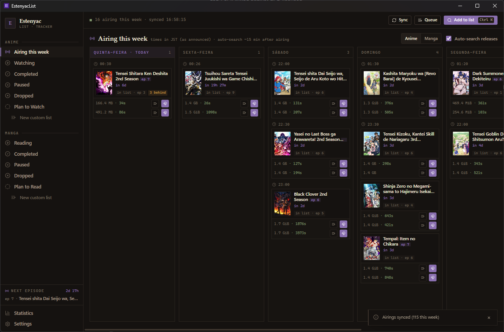
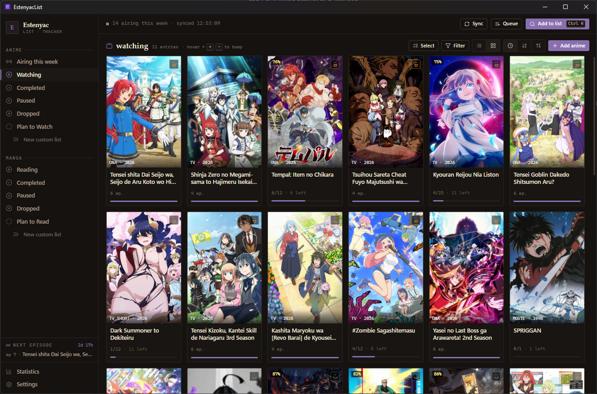
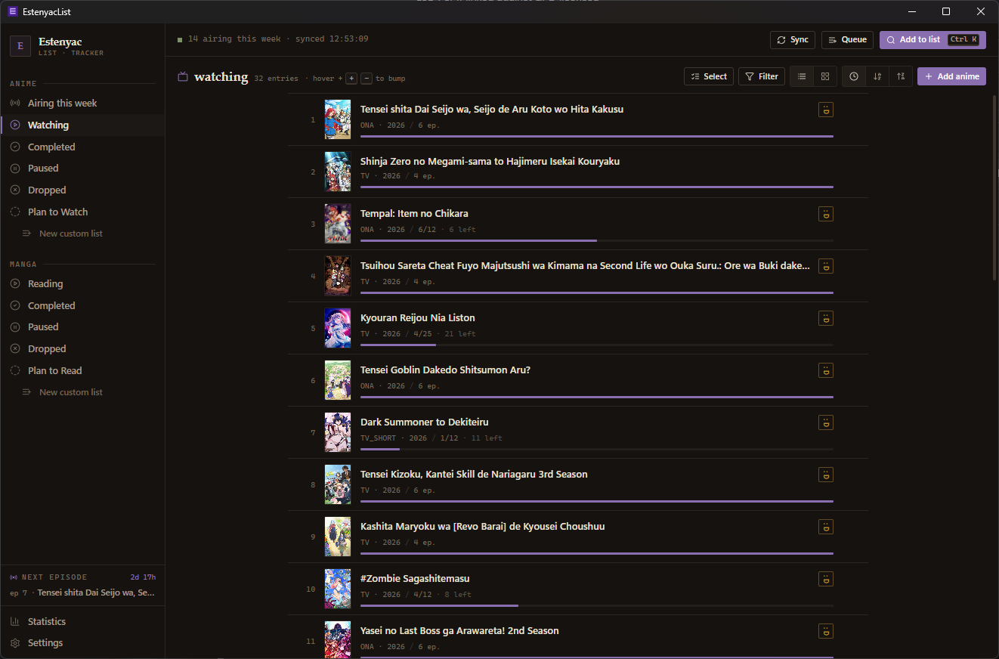
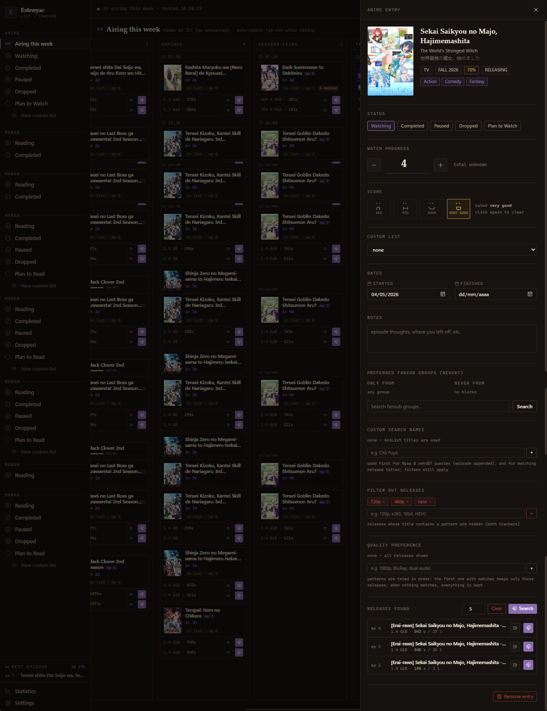
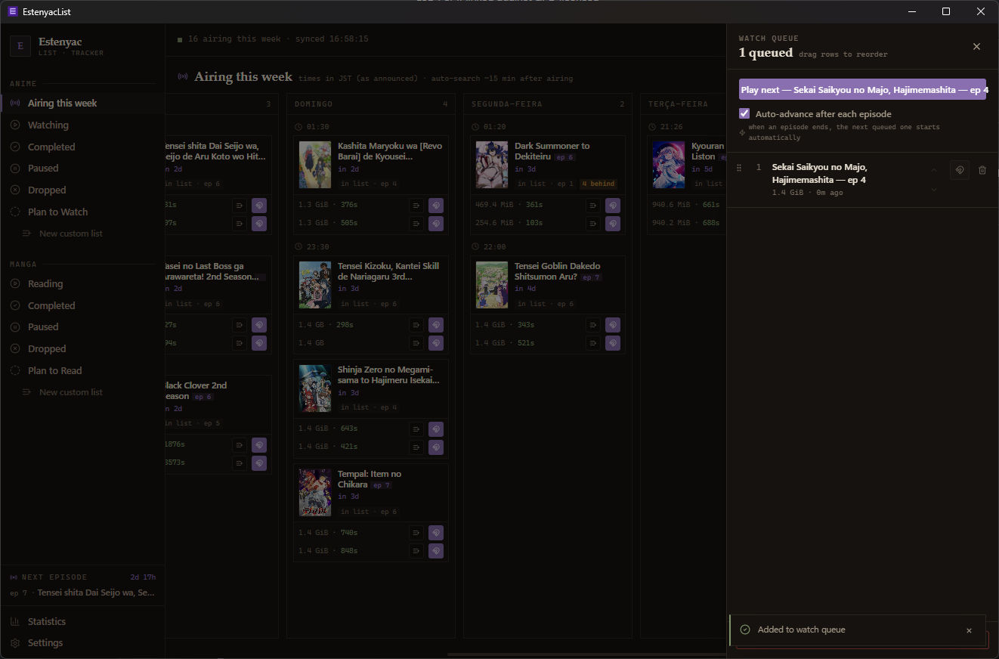
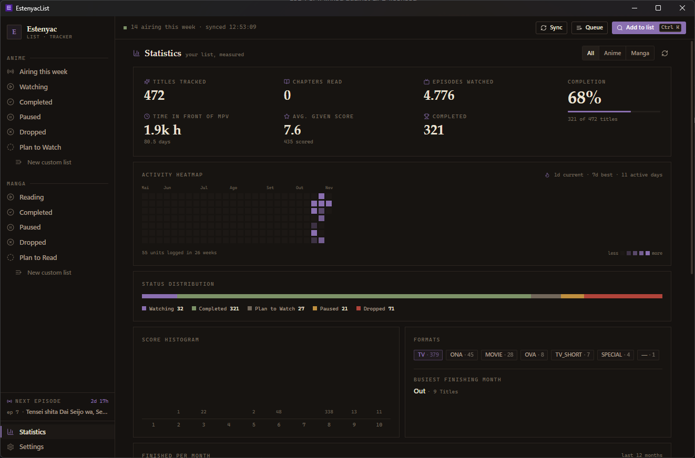
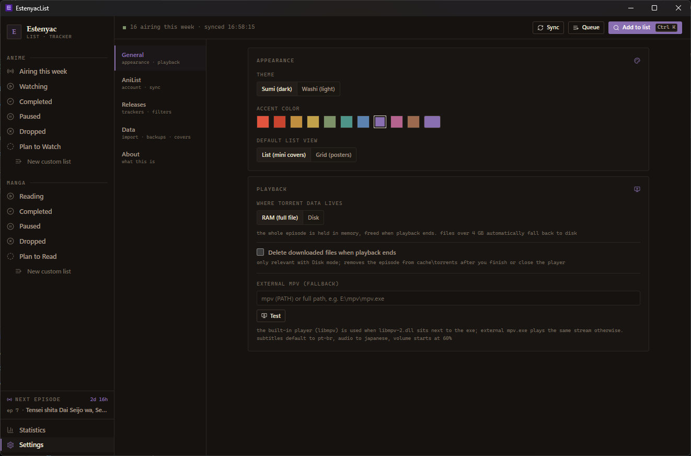
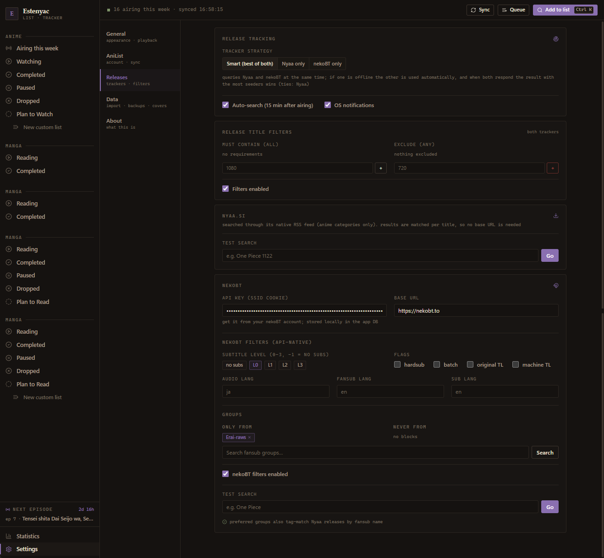

# EstenyacList

EstenyacList is a portable anime and manga tracker for Windows. It keeps your lists in a SQLite database next to the executable, pulls metadata from AniList, shows the current airing schedule, searches Nyaa and nekoBT for new episodes, and can stream torrents through an embedded rqbit engine into a built-in mpv player.

The app is built with Tauri 2 (Rust) and React with Tailwind CSS v4. It is designed for Windows 10 and Windows 11, x64 only.

## This project is 100% vibecoded

This is not a polished product from a software company. The entire application was built by prompting an AI coding agent. There has been no professional code review, no security audit, and no long-term maintenance plan.

It works for my personal use. Treat it as experimental software. Keep backups of your database, and do not run it somewhere where a bug or data loss would be costly.

## Screenshots

### Airing schedule

The weekly schedule is grouped by day and hour, with release results, torrent sizes, seeders, queue buttons, and playback buttons directly on each card.



### Anime list, grid view



### Anime list, list view



### Entry details

Progress, status, score, custom lists, dates, notes, fansub preferences, filters, and release search in one panel.



### Watch queue

Queue several releases, reorder them, and let the app advance automatically when an episode ends.



### Statistics

Tracked titles, episodes watched, time in the player, completion rate, activity heatmap, score histogram, and format breakdown.



### General settings

Dark and light themes, accent colors, list or grid view, RAM or disk streaming, and external mpv fallback.



### Release tracking settings

Nyaa and nekoBT configuration, saved title filters, quality preferences, fansub groups, and automatic searches after an episode airs.



## Features

- Anime and manga lists with watching, reading, completed, paused, dropped, and plan-to-watch statuses.
- Unlimited custom lists, separate for anime and manga.
- Scores with three emoji ratings: good, mid, and bad. Notes, start and finish dates, rewatches, and progress tracking are included.
- AniList search and metadata, plus optional AniList account sync with manual pull and automatic push.
- Weekly airing schedule in Japan Standard Time, grouped by day and hour, with countdowns to the next episode.
- Automatic release checks roughly 15 minutes after an episode airs, using Nyaa's RSS feed and the nekoBT API.
- Tracker strategy selection: Nyaa only, nekoBT only, or smart mode that queries both and picks the result with the most seeders.
- Saved release filters for required and excluded words, quality preferences, preferred fansub groups, and blocked groups.
- OS notifications when a matching release is found.
- Embedded rqbit torrent engine. The built-in player uses libmpv loaded from `libmpv-2.dll`, with external `mpv.exe` as a fallback.
- Streaming from RAM or disk, with an optional delete-after-watch mode.
- Watch queue with drag-to-reorder and optional auto-advance after each episode.
- Progress is updated automatically when an episode finishes.
- Statistics page with watch time, completion, activity heatmap, score histogram, and format breakdown.
- MAL-compatible XML import and export, plus rolling monthly backups stored next to the database.
- Cover images cached locally as JPEG XL for entries on your lists only.
- Portable data. The database, backups, cache, and logs live next to the executable.
- Dark and light themes, ten accent presets, and a custom accent color picker.

## Installation

Download the latest installer or portable build from the [releases page](https://github.com/Mahakali-sys/EstenyacList/releases/latest).

The installer is per-user and does not require administrator rights. It includes `libmpv-2.dll`, so the built-in player works without extra setup. The portable ZIP contains the same executable and DLL; extract it to a writable folder before running.

Requirements:

- Windows 10 or Windows 11, x64.
- Microsoft Edge WebView2 Runtime. It is already installed on current Windows 10 and Windows 11 systems.
- Optional: `mpv.exe` if you want the external player fallback. The bundled libmpv player does not need it.

The build is not code-signed. Windows SmartScreen may show a warning on first launch. Use the "More info" link and "Run anyway" if you trust the build.

## Where your data lives

Everything is stored next to `EstenyacList.exe`:

- `estenyac_list.db`: the SQLite database with your lists, settings, schedule, and cached metadata.
- `cache/images`: cached cover images.
- `cache/torrents`: temporary torrent data when disk mode is enabled.
- `estenyac_backup_YYYYMM.xml`: rolling monthly MAL-format backups, up to six months.
- `estenyac_search.log`: release search diagnostics.

To move the app, close it and copy the whole folder. To reset it, delete the database and cache folders. Make a backup before doing either.

## Building from source

Prerequisites:

- Windows 10 or Windows 11, x64.
- Node.js 20 or newer.
- Rust stable with the MSVC toolchain.
- Visual Studio 2022 Build Tools with the "Desktop development with C++" workload.
- WebView2 Runtime.

The repository does not contain `libmpv-2.dll`. The file is about 122 MB, which is over GitHub's normal file limit, and it is distributed with the release instead. To build the installer with the built-in player, place a compatible 64-bit `libmpv-2.dll` at the repository root before running the Tauri build. Windows builds of mpv and libmpv are available from the mpv project and from the mpv-winbuild-CMake project:

- https://mpv.io/installation/
- https://github.com/shinchiro/mpv-winbuild-cmake

The Tauri bundle configuration copies `libmpv-2.dll` from the repository root into the installer. The Rust code loads it at runtime through FFI. This project does not use the `libmpv-rs` crate. If the DLL is missing, the app falls back to launching an external `mpv.exe`, which can be configured in Settings.

Build commands:

```powershell
npm install
npm run build
npm run tauri build
```

The installer is written to `src-tauri/target/release/bundle/nsis/`. The unpacked executable is `src-tauri/target/release/estenyac-list.exe`.

For development:

```powershell
npm run tauri dev
```

The repository pins the toolchain versions used for release builds in `rust-toolchain.toml` (Rust 1.97.1) and `.nvmrc` (Node.js 22). `rustup` and `nvm` read these files automatically.

## Releases

Releases are built on GitHub Actions with the manual `Release` workflow in [.github/workflows/release.yml](.github/workflows/release.yml). The workflow reads the version from `src-tauri/tauri.conf.json`, checks that it matches `package.json` and `src-tauri/Cargo.toml`, refuses to run if the tag or release already exists, downloads the pinned libmpv binary from the `deps-libmpv-v0.41.0-1308` dependency release and verifies its SHA-256, builds the installer and portable ZIP, writes `SHA256SUMS.txt`, and creates the GitHub release.

The repository owner starts the workflow from the Actions tab. It is not triggered by pushes or tags. To release a new version, bump the version in all three files, commit and push, then run the workflow from `main`. If a release fails, delete the tag and release before retrying.

Release builds are not bit-for-bit reproducible. Building the same commit twice can produce different executables and installer hashes. Use the checksums attached to the release itself when verifying downloads, not a locally rebuilt binary.

## Licensing

The application source is licensed under the GNU General Public License, version 3 or later. See [LICENSE](LICENSE).

The release installer bundles `libmpv-2.dll` version `v0.41.0-1308-gbaa3e11d4`, which is part of mpv. mpv and libmpv are licensed under the GNU General Public License, version 2 or later. The corresponding source code is available from the mpv project:

- https://github.com/mpv-player/mpv
- https://github.com/mpv-player/mpv/tree/baa3e11d4

A copy of the GPL version 2 text is included in [licenses/GPL-2.0.txt](licenses/GPL-2.0.txt). The full third-party attribution list, including Rust crates and npm packages, is in [THIRD_PARTY_NOTICES.md](THIRD_PARTY_NOTICES.md).

Anime and manga metadata, cover images, and screenshots of cover art belong to their respective rights holders. AniList, Nyaa, nekoBT, mpv, and the other services and projects mentioned here are not affiliated with this project.

## Repository policy

This is a personal project. Issues are open for bug reports and questions. The repository is configured so that only the owner can push commits. Pull requests from other people are not accepted.

## Disclaimer

This software is provided without warranty. The app does not host or distribute anime, manga, or torrent files. It only queries public APIs and opens torrents that you choose. Downloading copyrighted material may be illegal where you live. You are responsible for how you use the software.
